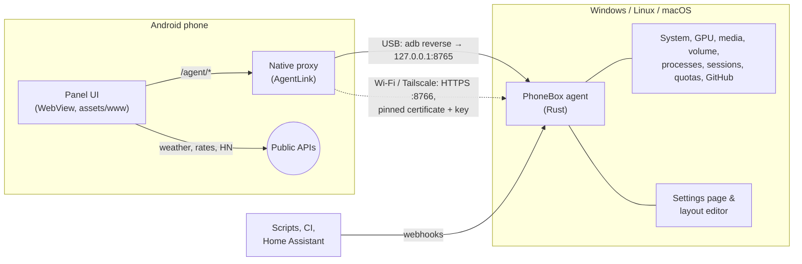

# Development guide

[Back to PhoneBox](../README.md) · [Installation and connections](SETUP.md) · [User guide](GUIDE.md)

[How it works](#how-it-works) · [Development](#development)

## How it works



- The WebView never talks to the PC directly: requests to `/agent/*` are intercepted by the app and forwarded over
  the adb tunnel (or the pinned HTTPS connection), so there are no CORS, mixed-content or local-network issues.
- Live events (page switches, notifications, permission prompts) arrive over one server-sent-events stream
  (`/api/stream`); plain polling remains as the fallback.
- The agent samples only what is on screen: process lists and command widgets run only while a phone looks at them.

## Development

Contributions are welcome: read [CONTRIBUTING.md](../CONTRIBUTING.md) first (scope, the security model, privacy and tests).

Use Rust 1.98 for the agent (rustup installs the version `agent-rs/rust-toolchain.toml` names, with clippy and
rustfmt), JDK 17 and Android SDK Platform 35 for Android builds, and Python 3 plus Node.js 22 for the browser
tooling. The Gradle wrapper downloads Gradle automatically.

Run the following commands from the repository root unless a working directory is shown.

### Local preview

```sh
python tools/demo-server.py
```

The server stays running in this terminal. Open <http://127.0.0.1:8790/panel/> or
<http://127.0.0.1:8790/settings/>. Use a second terminal for other commands.

### Checks

```sh
python tools/check-release.py
cd agent-rs && cargo fmt --all --check && cargo clippy --workspace --all-targets -- -D warnings && cargo test --workspace
```

The maintainer runs tests and agents on a Linux test server, not on the development machine:
`agent-rs/scripts/remote-check.sh [test-name filters]` (a bash script) copies the working tree, uncommitted changes
included, over ssh to the server named by `PHONEBOX_TEST_HOST` and runs the three cargo checks there.
`remote-cross-check.sh` compile-checks the Windows and macOS code on that server, and
`remote-parity.sh tools/parity/corpus/phase1.json` compares the Rust agent with the C# reference agent in `agent/`,
which stays until the switch is signed off. The rust workflow runs the same checks on Linux, macOS and Windows.

Browser tests need Node.js 22 and Chromium:

```sh
cd tools/ui-tests
npm ci
npx playwright install chromium
npx playwright test
```

On Linux CI, use `npx playwright install --with-deps chromium`. Playwright starts its own demo on port 8781.

### Build and run

On Windows, from the repository root:

```powershell
.\scripts\build.ps1 # release APK + the agent zip for this computer in dist/
```

`build.ps1` packages the host build only. The five release zips are built on native runners by the release
workflow; releases follow [the release checklist](RELEASING.md).

To build only the Android app with API compatibility lint:

```powershell
cd android
.\gradlew.bat lintDebug assembleDebug
```

Run the agent on any system with its own settings file and port (see [isolated agent runs](#isolated-agent-runs);
without them it uses the installed agent's settings and port 8765):

```sh
cd agent-rs
cargo run -p phonebox-agent -- --config <file> --port <n>
```

On Linux or macOS, build the APK with `cd android && ./gradlew assembleDebug`. Set `ANDROID_HOME` or
`android/local.properties` (`sdk.dir`) to the Android SDK location.

### Demo data and media

The demo server needs only Python. It serves the same demo as the [live one](https://ersinkoc.github.io/phonebox/)
(made-up data in [`tools/pages/demo.js`](../tools/pages/demo.js)) straight from the sources, so a reload shows your
changes. Size the browser window to 780 × 360 (the phone's screen in CSS pixels) and the panel behaves as on the
phone, including webhooks: `curl -X POST http://127.0.0.1:8790/api/notify -d hello` (also `/api/push/<key>`,
`/api/goto/<page>` and `/api/ask` for a made-up permission prompt).

With the demo server running, generate media from a second terminal:

```sh
cd tools/ui-tests
node media.js shots home system
node media.js tour
node media.js hero
```

Install the browser tooling above first. The tour also needs FFmpeg. Run `pwsh tools/make-icon.ps1` from the
repository root to regenerate the application icon.

### Source layout

The panel is plain ES modules: [`main.js`](../android/app/src/main/assets/www/main.js) (core, pages, navigation, data
from the agent) and the widgets in [`widgets/`](../android/app/src/main/assets/www/widgets). A widget is a
`{ needs, create(box, ctx) → { update(kind) } }` entry in the `W` registry, plus its styles in `style.css` and its catalogue entry
(name, size, options) in [`widgets.json`](../agent-rs/assets/widgets.json), which drives the settings editor.
Templates live in [`templates.json`](../agent-rs/assets/templates.json).

The agent lives in [`agent-rs/`](../agent-rs): the library crate `crates/phonebox` holds all the logic, with module
names that follow the C# files they were ported from, and `crates/phonebox-agent` builds the `PhoneBoxAgent`
program. The files it embeds (the settings page, `widgets.json`, `templates.json`, the default settings and the
icon) are in [`agent-rs/assets/`](../agent-rs/assets), and the panel comes from `android/app/src/main/assets/www`.

### Isolated agent runs

To check a development agent beside an installed one, run it with an isolated settings file and port, for example
`PhoneBoxAgent.exe --config "D:\test folder\config.json" --port 18765`. Settings and browser checks use
`http://127.0.0.1:18765/`; restarts preserve these arguments. The ordinary port remains 8765. Set `deviceSerial`
explicitly in the test settings (an unmatched serial disables USB attachment) and turn off automatic updates.
USB clients still use phone port 8765; do not assign the same phone to two agents at once.

### Release signing

Release APKs are signed with your own key when `PHONEBOX_STORE_FILE`, `PHONEBOX_STORE_PASSWORD`, `PHONEBOX_KEY_ALIAS`
and `PHONEBOX_KEY_PASSWORD` are set (in `~/.gradle/gradle.properties` or the environment); otherwise the debug key
is used. Debug builds make the WebView debuggable through `chrome://inspect`. To publish a release, follow
[the release checklist](RELEASING.md): the version lives in `agent-rs/Cargo.toml` and
`android/app/build.gradle.kts`, and the gated release workflow builds, signs and publishes it.
